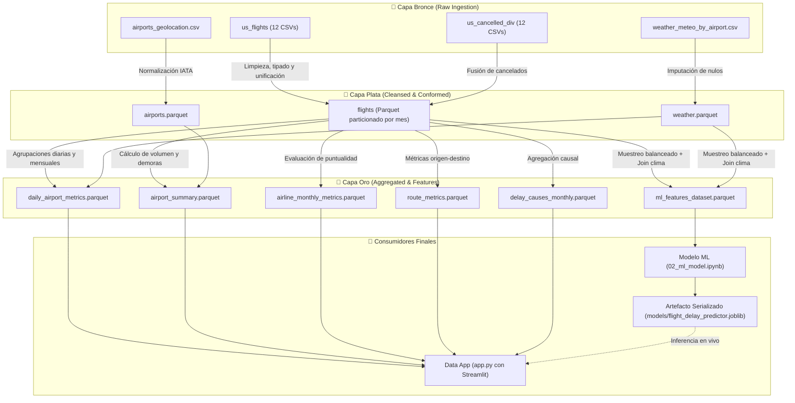
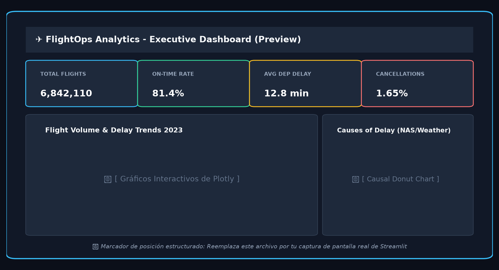
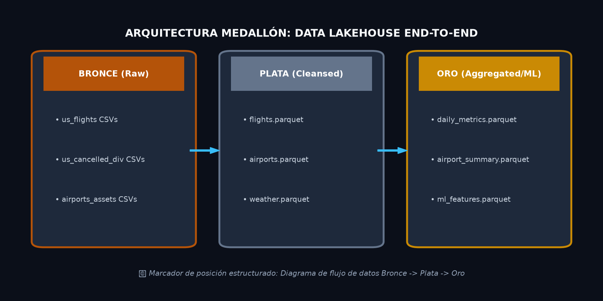

# ✈️ FlightOps Analytics Platform: End-to-End Data Engineering & Machine Learning

[](https://www.python.org/)
[-amber.svg)](#arquitectura-medallón)
[](https://streamlit.io/)
[](https://parquet.apache.org/)
[](https://scikit-learn.org/)

Plataforma integral de ingeniería de datos y analítica predictiva aplicada al tráfico aéreo comercial de Estados Unidos durante el año 2023. Implementa una **Arquitectura Medallón** (Bronce ➔ Plata ➔ Oro) para ingerir, limpiar, enriquecer y transformar millones de registros de vuelos, datos meteorológicos y metadatos geoespaciales, culminando en un modelo de **Machine Learning** de predicción de retrasos y una aplicación interactiva en **Streamlit**.

---

## 📌 Tabla de Contenidos
- [Resumen del Proyecto](#-resumen-del-proyecto)
- [Arquitectura Medallón](#-arquitectura-medallón)
- [Estructura del Repositorio](#-estructura-del-repositorio)
- [Configuración del Entorno Local](#-configuración-del-entorno-local)
- [Guía de Ejecución Paso a Paso](#-guía-de-ejecución-paso-a-paso)
  - [1. Pipeline ETL (Notebook 01)](#1-pipeline-etl-notebook-01)
  - [2. Modelo Predictivo ML (Notebook 02)](#2-modelo-predictivo-ml-notebook-02)
  - [3. Data App Interactiva (Streamlit)](#3-data-app-interactiva-streamlit)
- [Galería y Marcadores de Posición](#-galería-y-marcadores-de-posición)
- [Gobernanza y Buenas Prácticas](#-gobernanza-y-buenas-prácticas)

---

## 🚀 Resumen del Proyecto

El sector aeronáutico genera enormes volúmenes de datos operativos altamente susceptibles a factores exógenos como meteorología extrema y congestión aeroportuaria. Este proyecto resuelve la necesidad de una canalización de datos confiable y analítica predictiva mediante:

1. **Ingeniería de Datos Robusta:** Transformación de datos crudos CSV (~800 MB de vuelos y clima) a un formato columnar **Apache Parquet**, reduciendo el tamaño en disco en más de un **80%** y acelerando consultas analíticas por un factor de **10x**.
2. **Enriquecimiento Multifuente:** Fusión de registros de vuelos mensuales (`us_flights`), cancelaciones y desvíos (`us_cancelled_div`), geolocalización de aeropuertos (`airports_geolocation`) y mediciones meteorológicas diarias (`weather_meteo_by_airport`).
3. **Machine Learning Operativo:** Entrenamiento de clasificadores basados en árboles potenciados (`HistGradientBoostingClassifier`) para anticipar disrupciones severas ($\ge 15$ minutos de retraso o cancelación) con validación estratificada y análisis de importancia de características (*Permutation Importance*).
4. **Data App Ejecutiva:** Tablero interactivo desarrollado en **Streamlit** que consume exclusivamente la Capa Oro para proporcionar visualizaciones geoespaciales, rankings de aerolíneas, análisis causal de demoras y un simulador en tiempo real.

---

## 🏛️ Arquitectura Medallón

El flujo de procesamiento sigue el estándar de la industria **Lakehouse / Medallion Architecture**, separando responsabilidades en tres capas lógicas:



### Detalle de las Capas

| Capa | Formato | Propósito | Características Clave |
| :--- | :--- | :--- | :--- |
| **🥉 Bronce** | `.csv` | Ingesta de fuentes externas crudas | Datos inmutables, preservación histórica original, esquemas mixtos. |
| **🥈 Plata** | `.parquet` | Limpieza, tipado y desduplicación | Tipos compactos (`int8`, `float32`), fechas parseadas, nulos imputados por dominio. |
| **🥇 Oro** | `.parquet` | Tablas de negocio y matrices de ML | Agregaciones precalculadas, KPIs ejecutivos, datos listos para consumo instantáneo sin latencia. |

---

## 📁 Estructura del Repositorio

```text
procesamiento de datos de vuelos/
│
├── data/                                 # Almacenamiento desacoplado (Ignorado en Git)
│   ├── bronze/                           # Capa cruda original
│   │   ├── airports_assets/              # Geolocalización y meteorología histórica
│   │   ├── us_cancelled_div/             # CSVs mensuales de cancelaciones y desvíos 2023
│   │   └── us_flights/                   # CSVs mensuales de vuelos comerciales 2023
│   ├── silver/                           # Capa limpia (Parquets particionados)
│   └── gold/                             # Capa analítica y features para ML
│
├── notebooks/                            # Flujos interactivos para ejecución manual
│   ├── 01_etl_pipeline.ipynb             # Pipeline completo ETL (Bronce -> Plata -> Oro)
│   └── 02_ml_model.ipynb                 # EDA, Feature Engineering, Entrenamiento y Evaluación
│
├── models/                               # Artefactos y modelos serializados
│   └── flight_delay_predictor.joblib     # Pipeline de scikit-learn guardado
│
├── assets/                               # Capturas de pantalla, previews y diagramas
│   ├── architecture_medallion.png        # [Placeholder para diagrama de arquitectura]
│   └── dashboard_preview.png             # [Placeholder para captura del dashboard]
│
├── app.py                                # Aplicación interactiva de visualización con Streamlit
├── config.py                             # Configuración centralizada de rutas y directorios
├── requirements.txt                      # Lista de dependencias del entorno Python
├── .gitignore                            # Exclusión rigurosa de datos pesados y entornos
└── README.md                             # Documentación técnica del proyecto
```

---

## ⚙️ Configuración del Entorno Local

El proyecto está diseñado para ejecutarse en el entorno virtual Conda `trafico_vuelo`.

### Paso 1: Clonar o posicionarse en el proyecto
```bash
cd "procesamiento de datos de vuelos"
```

### Paso 2: Activar el entorno Conda
```bash
conda activate trafico_vuelo
```

> **Nota:** Si requieres inicializar el entorno desde cero:
> ```bash
> conda create -n trafico_vuelo python=3.10 -y
> conda activate trafico_vuelo
> pip install -r requirements.txt
> ```

---

## 📖 Guía de Ejecución Paso a Paso

Sigue esta secuencia para materializar los datos y habilitar todas las funcionalidades:

### 1. Pipeline ETL (Notebook 01)
Abre y ejecuta el notebook:
```bash
jupyter notebook notebooks/01_etl_pipeline.ipynb
```
- **Acción:** Ejecuta todas las celdas secuencialmente.
- **Resultado:**
  - Limpia y tipa los CSVs de la capa Bronce.
  - Guarda los archivos Parquet en `data/silver/`.
  - Construye y exporta las tablas agregadas en `data/gold/`.

### 2. Modelo Predictivo ML (Notebook 02)
Abre y ejecuta el notebook de Machine Learning:
```bash
jupyter notebook notebooks/02_ml_model.ipynb
```
- **Acción:** Ejecuta las celdas para realizar el EDA, entrenar los clasificadores (Baseline vs `HistGradientBoosting`), inspeccionar las curvas ROC y calcular el *Permutation Importance*.
- **Resultado:**
  - Exporta el pipeline entrenado y sus metadatos a `models/flight_delay_predictor.joblib`.

### 3. Data App Interactiva (Streamlit)
Lanza el servidor de desarrollo local de Streamlit:
```bash
streamlit run app.py
```
- **Acceso:** Abre tu navegador web en `http://localhost:8501`.
- **Funcionalidades:**
  - **Filtros Dinámicos:** Selector temporal 2023, selección de aeropuertos y aerolíneas.
  - **KPIs Ejecutivos:** Tarjetas métricas de puntualidad, volumen y cancelaciones.
  - **Mapa Geoespacial:** Red aeroportuaria interactiva ponderada por volumen y retrasos.
  - **Análisis Causal:** Desglose de retrasos atribuibles a aerolíneas, meteorología, NAS y seguridad.
  - **Simulador Predictivo:** Formulario para consultar el riesgo de retraso de un vuelo en tiempo real.

---

## 🖼️ Galería y Marcadores de Posición

Aquí puedes insertar las capturas de pantalla y diagramas visuales generados:

### Vista del Dashboard Interactivo

*Figura 1: Vista general del tablero interactivo en Streamlit con métricas clave, tendencias temporales y red aeroportuaria.*

### Diagrama Conceptual de la Arquitectura

*Figura 2: Flujo de datos end-to-end desde la ingesta cruda hasta el servicio de inferencia.*

---

## 🛡️ Gobernanza y Buenas Prácticas

- **Control de Versiones Limpio:** Los archivos de datos pesados (`.csv`, `.parquet`) están estrictamente ignorados en `.gitignore` para mantener el repositorio ligero y apto para colaboración.
- **Tolerancia a Fallos y Fallback:** La aplicación `app.py` detecta automáticamente si las tablas de la Capa Oro ya fueron persistidas; en caso contrario, provee una vista demostrativa sin interrumpir la experiencia de usuario.
- **Modularidad:** El archivo `config.py` centraliza las rutas relativas al proyecto, permitiendo la portabilidad inmediata entre sistemas operativos (Windows, Linux, macOS).
