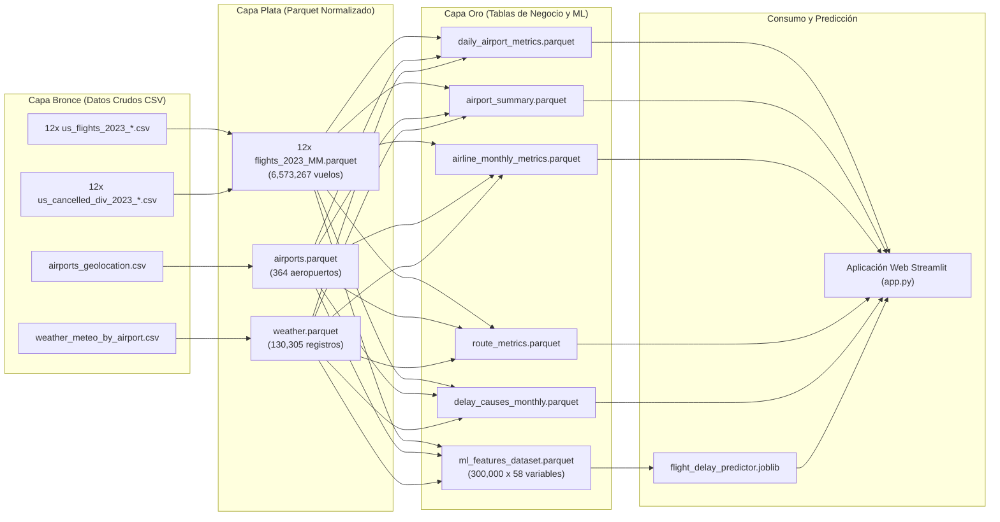
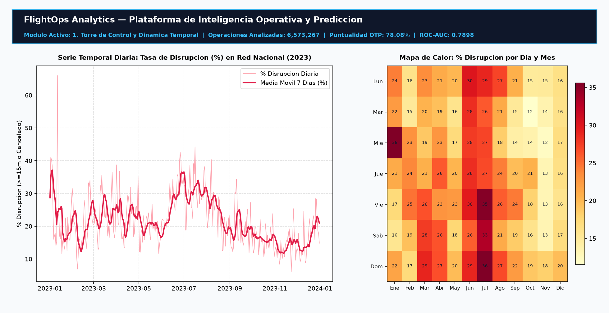
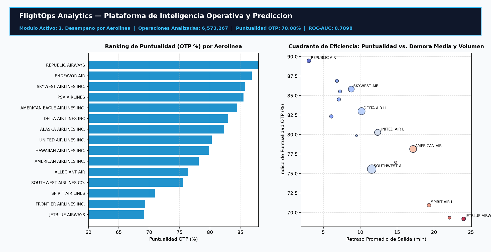
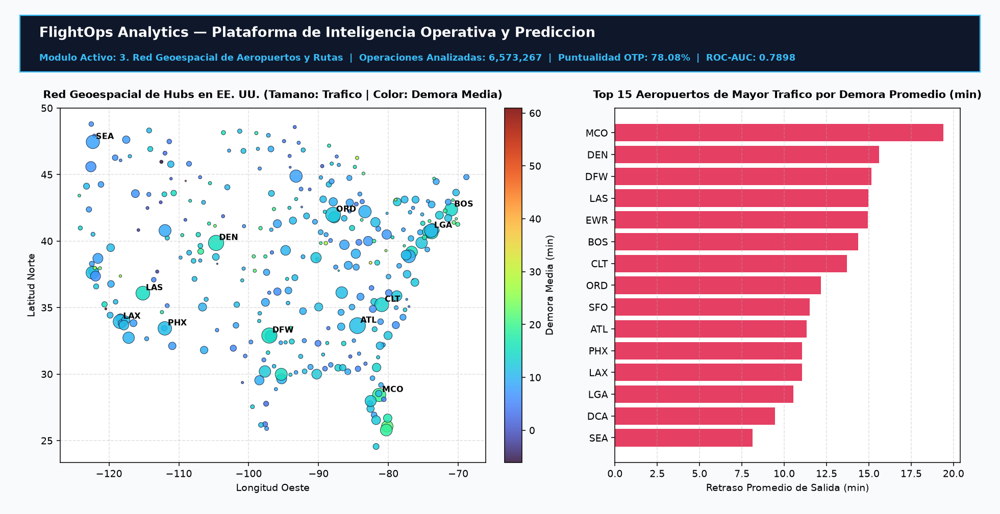
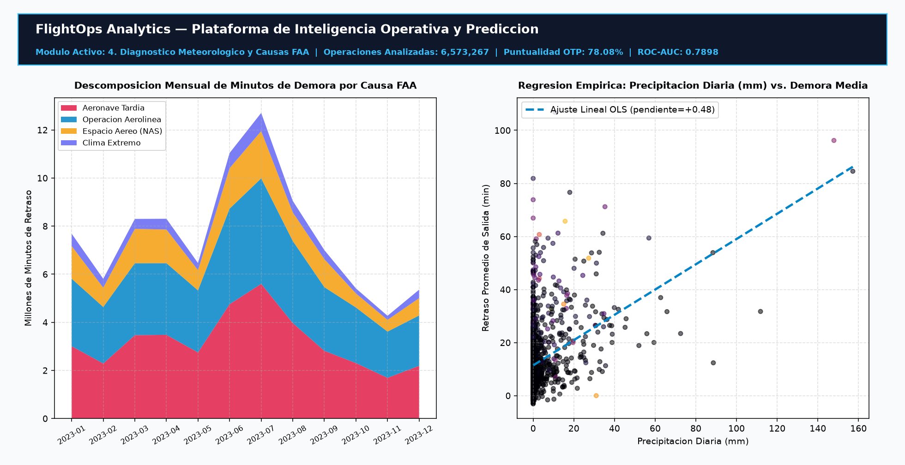
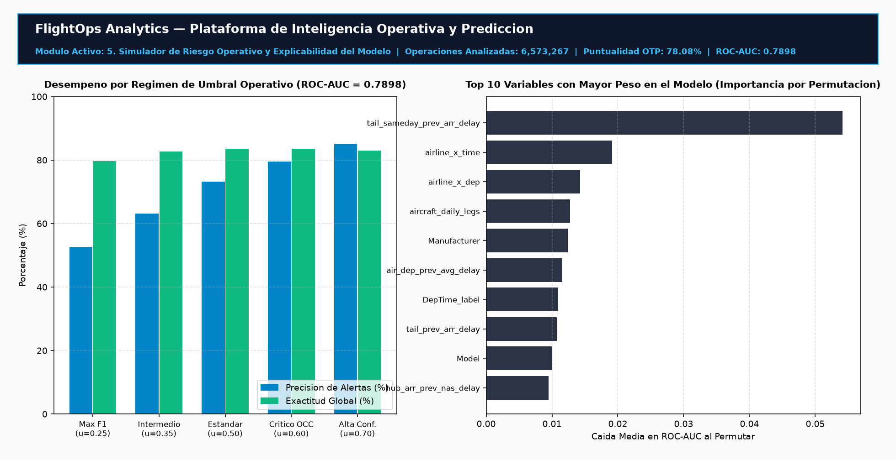

# FlightOps Analytics — Plataforma de Inteligencia Operativa y Predicción de Tráfico Aéreo

[](https://www.python.org/)
[](https://parquet.apache.org/)
[](https://scikit-learn.org/)
[](https://streamlit.io/)
[](https://plotly.com/)
[](LICENSE)

Manual técnico e instructivo de operación de **FlightOps Analytics**, una plataforma de ingeniería de datos y predicción de disrupciones aéreas desarrollada sobre el registro histórico de operaciones comerciales y meteorología de Estados Unidos correspondiente al año **2023** (**6,573,267 vuelos**, **364 aeropuertos** y **130,305 observaciones meteorológicas diarias**).

---

## Tabla de Contenidos

- [1. Descripción General del Sistema](#1-descripción-general-del-sistema)
- [2. Requisitos e Instructivo de Ejecución](#2-requisitos-e-instructivo-de-ejecución)
- [3. Arquitectura de Datos (Modelo Medallón)](#3-arquitectura-de-datos-modelo-medallón)
- [4. Guía Visual de Usuario de la Aplicación (`app.py`)](#4-guía-visual-de-usuario-de-la-aplicación-apppy)
- [5. Metodología del Modelo Predictivo y Métricas de Rendimiento](#5-metodología-del-modelo-predictivo-y-métricas-de-rendimiento)
- [6. Ejecución y Mantenimiento de Pipelines (Notebooks)](#6-ejecución-y-mantenimiento-de-pipelines-notebooks)
- [7. Estructura del Repositorio](#7-estructura-del-repositorio)
- [8. Comandos Git para Publicación en GitHub](#8-comandos-git-para-publicación-en-github)
- [9. Licencia](#9-licencia)

---

## 1. Descripción General del Sistema

**FlightOps Analytics** integra en una sola solución tres componentes principales:

1. **Pipeline ETL de Tres Capas (Bronce, Plata y Oro):** Procesa 26 archivos CSV crudos y los transforma en particiones columnares comprimidas (`Apache Parquet`), reduciendo el uso de almacenamiento y memoria en más de un 80%.
2. **Motor Predictivo de Disrupciones Aéreas (`HistGradientBoostingClassifier`):** Estima la probabilidad de que un vuelo programado sufra un retraso severo en la salida ($\ge 15$ minutos, estándar oficial de la FAA/DOT) o sea cancelado, utilizando **70 variables causales pre-vuelo** que incluyen meteorología en origen y destino, congestión de franjas horarias y propagación de demoras del tramo previo de la aeronave.
3. **Aplicación Web Interactiva ([`app.py`](app.py)):** Centro de monitoreo operativo con cinco módulos de visualización, filtros dinámicos por fecha, aerolínea y aeropuerto, y un simulador de riesgo en tiempo real.

---

## 2. Requisitos e Instructivo de Ejecución

### 2.1 Entorno de Ejecución

El proyecto utiliza Python con las siguientes librerías principales detalladas en [`requirements.txt`](requirements.txt):
- `python >= 3.10` (probado en `Python 3.13`)
- `pandas >= 2.2`, `numpy >= 1.26`, `pyarrow >= 15.0`
- `scikit-learn >= 1.5`, `joblib >= 1.3`
- `streamlit >= 1.38`, `plotly >= 5.20`, `matplotlib >= 3.8`, `seaborn >= 0.13`

Para clonar e instalar las dependencias en un entorno virtual limpio:

```bash
# 1. Clonar el repositorio
git clone https://github.com/EzequielJaramillo/flightops-air-traffic-analytics.git
cd procesamiento-datos-vuelos

# 2. Crear y activar entorno virtual
python -m venv .venv
# Windows (PowerShell):
.\.venv\Scripts\Activate.ps1
# Linux / macOS:
source .venv/bin/activate

# 3. Instalar dependencias
pip install -r requirements.txt
```

### 2.2 Cómo Iniciar la Aplicación Web

El archivo [`app.py`](app.py) cuenta con un iniciador automático integrado en su cabecera que detecta si se ejecuta directamente desde un editor de código (`python app.py`) y levanta automáticamente el servidor de Streamlit sin errores de contexto (`ScriptRunContext`).

Puede iniciar la plataforma mediante cualquiera de los siguientes tres métodos:

- **Método 1 — Ejecución estándar con Streamlit:**
  ```bash
  streamlit run app.py
  ```
- **Método 2 — Ejecución directa con Python (Botón "Run" del IDE o terminal):**
  ```bash
  python app.py
  ```
- **Método 3 — Ejecución mediante archivo por lotes (Windows):**
  Haga doble clic sobre el archivo [`iniciar_app.bat`](iniciar_app.bat) ubicado en la raíz del proyecto.

Una vez iniciado el servidor, acceda desde su navegador web a la dirección:
- **URL Local:** `http://localhost:8501`

---

## 3. Arquitectura de Datos (Modelo Medallón)



### Detalle de las Tablas en la Capa Oro (`data/gold/`)

| Archivo Parquet | Propósito en la Plataforma |
| :--- | :--- |
| `daily_airport_metrics.parquet` | Volumen diario de vuelos, retrasos severos, cancelaciones y meteorología por aeropuerto de salida. |
| `airport_summary.parquet` | Indicadores anuales consolidados por aeropuerto con coordenadas geográficas (latitud y longitud). |
| `airline_monthly_metrics.parquet` | Desempeño mensual de puntualidad (OTP) y tasas de cancelación por aerolínea comercial. |
| `route_metrics.parquet` | Estadísticas de tráfico, duración media, retraso promedio y cancelación por par origen-destino. |
| `delay_causes_monthly.parquet` | Minutos mensuales de demora desglosados en las 5 categorías oficiales de la FAA. |
| `ml_features_dataset.parquet` | Muestra estratificada de 300,000 vuelos con 58 variables base (clima dual y estado operativo previo). |

---

## 4. Guía Visual de Usuario de la Aplicación (`app.py`)

En la barra lateral izquierda de la aplicación se encuentran los **filtros globales** (rango de fechas del año 2023, selección de aerolíneas operadoras y filtrado opcional por aeropuertos de salida), los cuales actualizan dinámicamente las tarjetas de indicadores superiores y los cinco módulos de análisis.

### Módulo 1: Torre de Control y Dinámica Temporal
Permite inspeccionar la evolución diaria del volumen de vuelos frente al porcentaje de disrupciones ($\ge 15$ min o cancelados), incorporando una media móvil de 7 días para identificar picos estacionales y un mapa de calor cruzado por día de la semana y mes del año.



---

### Módulo 2: Desempeño por Aerolínea
Presenta la clasificación comparativa de puntualidad (*On-Time Performance*, OTP) de cada operador comercial, un gráfico de cuadrantes (Puntualidad vs. Retraso Promedio de Salida ponderado por volumen anual de vuelos) y la evolución mensual de puntualidad a lo largo del año.



---

### Módulo 3: Red Geoespacial de Aeropuertos y Rutas
Muestra la cartografía nacional de aeropuertos en Estados Unidos dimensionada por volumen de salidas anuales y coloreada según la demora promedio, junto con el ranking de los 15 aeropuertos de mayor tráfico y la tabla interactiva de las 20 rutas comerciales de alta densidad con mayor retraso promedio.



---

### Módulo 4: Diagnóstico Meteorológico y Causas FAA
Desglosa los minutos de retraso acumulados según las cinco categorías oficiales de la FAA (*Aeronave Tardía*, *Operación de Aerolínea*, *Sistema Nacional de Espacio Aéreo NAS*, *Meteorología Extrema* y *Seguridad*) e incorpora una herramienta interactiva de regresión lineal por mínimos cuadrados ordinarios (OLS) para cuantificar el impacto de la precipitación, el viento, la nieve, la temperatura y la presión atmosférica sobre las demoras diarias.



---

### Módulo 5: Simulador de Riesgo Operativo
Permite al usuario configurar los parámetros de un vuelo programado (aeropuerto de origen y destino, aerolínea, mes, día de la semana, franja horaria, edad de la aeronave, duración estimada, condiciones meteorológicas pronosticadas y estado operativo observado en el bloque horario previo) para obtener en tiempo real:
1. La **probabilidad calibrada de disrupción** en un velocímetro interactivo.
2. La **recomendación operativa** según el régimen de umbral seleccionado (`0.25`, `0.35`, `0.50`, `0.60` o `0.70`).
3. El **gráfico de importancia de variables** por permutación del modelo predictivo.



---

## 5. Metodología del Modelo Predictivo y Métricas de Rendimiento

### 5.1 Formulación Causal sin Fuga de Información (Zero Data Leakage)

En la operación aérea comercial, el día se estructura en cuatro bloques horarios sucesivos:

$$\text{Día }(t-1) \longrightarrow \text{Morning }(s=1) \longrightarrow \text{Afternoon }(s=2) \longrightarrow \text{Evening }(s=3) \longrightarrow \text{Night }(s=4)$$

Antes de la salida de cualquier vuelo en la franja horaria $s$, el estado operativo registrado en la **franja inmediatamente anterior ($s - 1$)** ya es conocido. El pipeline de ingeniería de características construye **70 variables predictivas** agrupadas en cuatro familias:

1. **Estado de Rotación Intradía de la Aeronave (`Tail_Number` en $s - 1$):**
   - `tail_sameday_prev_dep_delay`, `tail_sameday_prev_arr_delay` y `tail_sameday_prev_disrupted`: Capturan si la misma aeronave sufrió retraso en su tramo previo del mismo día, diferenciándolo del reinicio nocturno (`tail_has_sameday_prev`).
   - `tail_roll3_disrupted`: Tasa móvil de disrupción en los últimos 3 vuelos operados por la matrícula.
2. **Estado Operativo Previo en Aeropuertos de Origen y Destino ($s - 1$):**
   - `hub_dep_prev_disrupt_rate`, `hub_dep_prev_avg_delay`, `hub_dep_prev_cancel_rate` y demoras medias por causa FAA (`hub_dep_prev_wx_delay`, `hub_dep_prev_nas_delay`, `hub_dep_prev_late_ac_delay`) en el bloque horario anterior.
   - `hub_arr_prev_disrupt_rate`, `hub_arr_prev_avg_delay` y `hub_arr_prev_nas_delay` en el aeropuerto de destino.
3. **Meteorología Dual (Origen y Destino) e Indicadores Físicos:**
   - Temperatura (`tavg`, `tmin`, `tmax`), precipitación (`prcp`), nieve (`snow`), viento (`wspd`) y presión (`pres`) en ambos extremos de la ruta.
   - Indicador físico de riesgo de congelamiento/deshielo en pista (`deicing_risk` cuando $T_{\min} \le 0^\circ\text{C}$ con precipitación o nieve), caída barométrica (`pres_drop`) y amplitud térmica diaria (`temp_swing`).
4. **Codificación Bayesiana Out-of-Fold (`TargetEncoder` con `StratifiedKFold(5)`):**
   - Aplicada sobre rutas e interacciones espacio-temporales (`route`, `dep_x_time`, `arr_x_time`, `airline_x_time`, `dep_x_month`, `airline_x_dep`).

### 5.2 Resultados en el Conjunto de Prueba (60,000 Vuelos)

| Métrica / Régimen de Umbral Operativo | Modelo Base Inicial | Modelo Estático + Clima Dual | Modelo Final Causal (`HistGradientBoosting`) | Mejora Total |
| :--- | :---: | :---: | :---: | :---: |
| **ROC-AUC** | `0.7177` | `0.7346` | **`0.7898`** | **+7.21 pts ROC-AUC** |
| **PR-AUC (Average Precision)** | `0.4410` | `0.4876` | **`0.6112`** | **+17.02 pts PR-AUC** |
| **F1-Score (Umbral Equilibrado `0.25`)** | `0.4614` | `0.4727` | **`0.5474`** | **+8.60 pts F1** (Precisión `52.6%`, Recall `57.0%`) |
| **Umbral Intermedio (`0.35`)** | — | `51.7%` Prec. | **Precisión `63.1%`** | Recall **`47.2%`** / Exactitud **`82.7%`** |
| **Umbral Estándar (`0.50`)** | `36.2%` Prec. | `68.5%` Prec. | **Precisión `73.2%`** | **+37.0 pts Precisión** (Recall `36.9%`, Exactitud **`83.6%`**) |
| **Umbral Crítico de Control (`0.60`)** | — | `79.7%` Prec. | **Precisión `79.5%`** | Recall **`31.6%`** / Exactitud **`83.6%`** |
| **Umbral de Alta Confianza (`0.70`)** | — | — | **Precisión `85.2%`** | Recall **`25.2%`** / Exactitud **`83.0%`** |

---

## 6. Ejecución y Mantenimiento de Pipelines (Notebooks)

Si desea regenerar las tablas desde los archivos CSV originales o reentrenar el modelo predictivo:

1. **Ejecutar el Pipeline ETL ([`notebooks/01_etl_pipeline.ipynb`](notebooks/01_etl_pipeline.ipynb)):**
   Procesa las fuentes de `data/bronze/`, genera los archivos limpios en `data/silver/` y construye las 6 tablas analíticas en `data/gold/`.
2. **Ejecutar el Entrenamiento del Modelo ([`notebooks/02_ml_model.ipynb`](notebooks/02_ml_model.ipynb)):**
   Entrena los clasificadores, evalúa los umbrales operativos, calcula la importancia de variables por permutación y exporta el artefacto [`models/flight_delay_predictor.joblib`](models/flight_delay_predictor.joblib).

Ambos notebooks pueden reconstruirse programáticamente ejecutando:

```bash
python scripts/generate_notebooks.py
```

---

## 7. Estructura del Repositorio

```text
procesamiento de datos de vuelos/
├── app.py                              # Aplicación web interactiva en Streamlit
├── config.py                           # Configuración centralizada de rutas del proyecto
├── iniciar_app.bat                     # Lanzador rápido para sistemas Windows
├── requirements.txt                    # Lista de dependencias de software
├── .gitignore                          # Exclusión de entornos virtuales y artefactos temporales
├── LICENSE                             # Licencia MIT del proyecto
├── README.md                           # Manual técnico y guía de usuario
├── assets/                             # Capturas e imágenes de los módulos de la aplicación
│   ├── 01_torre_control.png
│   ├── 02_desempeno_aerolineas.png
│   ├── 03_red_aeropuertos_rutas.png
│   ├── 04_diagnostico_meteorologico_faa.png
│   ├── 05_simulador_riesgo_operativo.png
│   ├── architecture_medallion.png
│   └── dashboard_preview.png
├── data/
│   ├── bronze/                         # 26 archivos CSV crudos originales
│   ├── silver/                         # 14 archivos Parquet normalizados
│   └── gold/                           # 6 tablas analíticas y dataset de entrenamiento ML
├── models/
│   └── flight_delay_predictor.joblib   # Pipeline predictivo entrenado y tablas de referencia
├── notebooks/
│   ├── 01_etl_pipeline.ipynb           # Flujo ETL de arquitectura Medallón
│   └── 02_ml_model.ipynb               # Ingeniería de características y modelado predictivo
└── scripts/
    └── generate_notebooks.py           # Generador automatizado de los notebooks
```

---
---

## 8. Licencia

Distribuido bajo la licencia **MIT**. Consulta el archivo [`LICENSE`](LICENSE) para más detalles.
